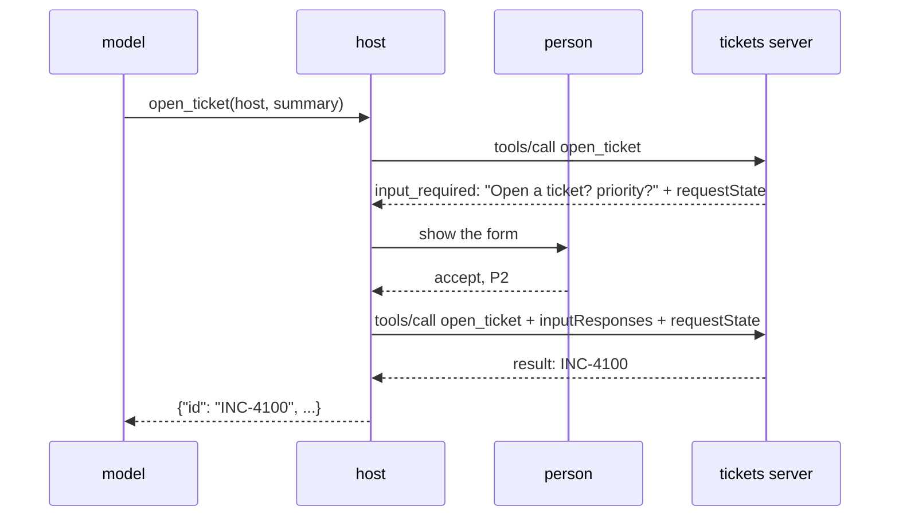

**Goal:** build the other end of the protocol, a **host**: the application that starts MCP
servers, hands their tools to `gpt-oss-120b`, runs the tool calls the model asks for, and asks
the *person* (never the model) when a server needs a decision. You'll run two servers at once,
Unit 1's CMDB server and a new ticketing server whose one write action asks for confirmation
with the 2026 protocol's `input_required`.

**Where this fits:** Unit 1 built a server and drove it from a script. Here a model does the
choosing. This unit builds on [Foundations §15](../../lessons/15-the-tool-use-loop.md) (the
tool-use loop) and [§18](../../lessons/18-model-context-protocol.md) (§18's bridge did a small
version of this by hand). The host you build is also the harness the rest of the course reuses:
Unit 3 measures catalogs through it, Unit 6 A/B-tests tool descriptions through it, and Unit 11
turns it into an eval runner. It still needs no Docker: both servers run on in-memory data.

---

## Host, client, server

The spec names three roles, and the names matter because the responsibilities differ:

- The **host** is the application the person uses: Claude Code, an IDE, or the script you're
  about to write. It owns the model, the conversation, the person, and every decision about
  what reaches the model.
- A **client** is the host's connection to *one* server. The host creates one per server.
- A **server** offers tools, resources and prompts, and knows nothing about the model or the
  other servers.

```text
             ┌─────────────────────── host ───────────────────────┐
  person ◄──►│ conversation · model · tool table · elicitation UI │
             │      Client("cmdb")            Client("tickets")   │
             └──────────┬───────────────────────────┬─────────────┘
                        │ stdio                     │ stdio
                 cmdb_server.py              tickets_server.py
```

Two consequences shape the rest of the unit:

1. **Servers can't see each other.** Neither can one server see the conversation. If the CMDB
   server returns a hostname and the model passes it to the ticketing server, only the host
   knows those two calls are related. That's why the joinable ids are the host's job: it mints
   the `trace_id` and counts the `step`.
2. **The host is the policy point nobody can bypass.** It decides which tools the model is
   offered, whether a call the model asks for is dispatched, how much of a result goes back into
   the context, and who answers a server's question. Unit 7 puts identity and policy here too.

## A server that asks first

Opening a ticket changes something, so the server shouldn't do it just because a model asked.
In the 2024 protocol, a server asked the user by sending its own request back to the client in
the middle of a call (`elicitation/create`). That needed a long-lived connection that both sides
could send on, which is exactly what 2026-07-28 removed.

The 2026 answer is the **multi-round-trip call**. The server *answers* the call with
`resultType: "input_required"` and the questions it needs answered. The client asks the person,
then sends the *same call again* with the answers attached. Nothing waits on the server between
the two rounds, so the second round can land on a different server instance.



Refresh your copy of the course helper first. This unit moves Unit 1's joinable-log middleware
into it as `joinable_log(server_name)`, so every server logs the same way, and adds
`trace_meta()`, the function your Unit 1 client defined for itself:

```bash
cp examples/common_mcp.py work/
```

Create **`work/tickets_server.py`**:

```python
import itertools
from typing import Literal, TypedDict

from common_mcp import joinable_log
from mcp.server.mcpserver import Context, MCPServer
from mcp.server.mcpserver.exceptions import ToolError
from mcp.types import ElicitRequest, ElicitRequestFormParams, InputRequiredResult

mcp = MCPServer(
    "tickets",
    version="0.1.0",
    instructions="Incident tickets. Opening a ticket always asks the user to confirm it first.",
)
mcp.middleware.append(joinable_log("tickets"))

TICKETS: list[dict] = []
_ids = itertools.count(4100)
ASKED = "asked-the-user"   # sealed by the SDK and echoed back by the client: proof we asked


class Ticket(TypedDict):
    id: str
    host: str
    summary: str
    priority: Literal["P1", "P2", "P3"]
    status: Literal["open", "closed"]


@mcp.tool()
async def open_ticket(host: str, summary: str, ctx: Context) -> Ticket | InputRequiredResult:
    """Open an incident ticket about a host. The user is asked to confirm it and to choose its
    priority before anything is created; if they decline, no ticket is opened."""
    caps = ctx.client_capabilities
    if caps is None or caps.elicitation is None:
        raise ToolError("opening a ticket needs a host that can ask the user to confirm it, and "
                        "this one can't. No ticket was opened; tell the user to open it by hand.")

    answer = (ctx.input_responses or {}).get("confirm")
    if answer is None or ctx.request_state != ASKED:   # round 1: ask, and stop here
        return InputRequiredResult(request_state=ASKED, input_requests={"confirm": ElicitRequest(
            params=ElicitRequestFormParams(
                message=f"Open an incident ticket for {host}?\n\n{summary}",
                requested_schema={
                    "type": "object",
                    "properties": {"priority": {
                        "type": "string", "enum": ["P1", "P2", "P3"],
                        "description": "P1 = drop everything, P3 = next business day"}},
                    "required": ["priority"],
                },
            ))})

    if answer.action != "accept":            # round 2: the user said no (or closed the form)
        said = "declined" if answer.action == "decline" else "closed the form"
        raise ToolError(f"the user {said}: no ticket was opened. Don't retry unless they "
                        "ask again.")
    priority = (answer.content or {}).get("priority")
    if priority not in ("P1", "P2", "P3"):
        raise ToolError("the confirmation came back without a valid priority; no ticket was opened.")
    ticket = {"id": f"INC-{next(_ids)}", "host": host, "summary": summary,
              "priority": priority, "status": "open"}
    TICKETS.append(ticket)
    return ticket


class TicketList(TypedDict):
    total: int
    tickets: list[Ticket]


@mcp.tool()
def list_tickets(host: str | None = None) -> TicketList:
    """List the incident tickets opened so far, optionally only those about one host."""
    found = [t for t in TICKETS if host is None or t["host"] == host]
    return {"total": len(found), "tickets": found}


if __name__ == "__main__":
    mcp.run()
```

Read `open_ticket` as three guards, in order:

- **Fail closed without the capability.** A client declares in `clientCapabilities` whether it
  can show a form to a person. If it can't, the tool refuses instead of deciding on the
  person's behalf. The error tells the model what to say to the user.
- **Ask unless this is a genuine second round.** The form is plain JSON Schema with flat,
  primitive properties: the host has to render it, so keep it to strings, numbers, booleans and
  enums. An `enum` becomes a dropdown in the lab.
- **Treat anything but `accept` as no.** The person can `decline` or `cancel` (close the form
  without answering). Both mean nothing happens, and the error tells the model not to keep
  asking.

The `request_state` line needs its own paragraph, because without it the confirmation is
decoration. The second round is just another `tools/call` with an `inputResponses` field, and
nothing stops a client from sending that field on the *first* call. Remove the `request_state`
check and send `{"confirm": {"action": "accept", "content": {"priority": "P1"}}}` straight
away: a ticket opens, and nobody was asked. With the check, round 2 has to echo the
`requestState` from round 1. The SDK **seals** that value (AES-GCM under a key only the server
holds) and binds it to the tool name, a digest of the arguments, and a ten-minute expiry. A
client can't mint one, can't edit one, and can't reuse one to open a ticket for a *different*
host: the server refuses with `-32602 Invalid or expired requestState`. By default the key is
generated when the server process starts, so a restart between the two rounds (or a second
instance answering round 2) refuses the answer too. Unit 9 gives every instance a shared key.

What it can't prove is that the person, rather than the host's code, clicked "accept". That's
the boundary of this mechanism: **elicitation is the host's promise to ask, not proof that it
did.** It's the right tool for "make sure the user meant it". It's not an approval control for
an action that needs one. Those live outside the host's reach, with an approver and an audit
trail, in enterprise track E1.

*(Reference: [`examples/02/tickets_server.py`](../examples/02/tickets_server.py).)*

## Build the host

Create **`work/host.py`**. Start with the servers, the system prompt, and a name scheme:

```python
import argparse
import asyncio
import json
import re
import sys
import time
import uuid
from contextlib import AsyncExitStack
from dataclasses import asdict, dataclass
from pathlib import Path

from common_mcp import llm, trace_meta
from mcp import Client, StdioServerParameters
from mcp.types import ElicitResult, Implementation

HERE = Path(__file__).resolve().parent
SERVERS = {
    "cmdb": HERE / "cmdb_server.py",
    "tickets": HERE / "tickets_server.py",
}
SYSTEM = (
    "You are an assistant for a security operations team. Use the tools to look things up; "
    "never guess a hostname, owner or ticket id. Say plainly when a tool returns an error, "
    "and never claim a ticket was opened unless the tool returned its id."
)
_NOT_ALLOWED = re.compile(r"[^a-zA-Z0-9_-]")


def namespaced(server: str, tool: str) -> str:
    """`server__tool`, made safe for OpenAI tool names (^[a-zA-Z0-9_-]{1,64}$)."""
    return _NOT_ALLOWED.sub("_", f"{server}__{tool}")[:64]
```

Every server names its tools without knowing about the others, so two servers will sooner or
later both offer `search`. The model sees one flat list, so the host has to make the names
unique. Prefixing the server name does that, and it tells the model *where* a tool lives, which
helps it choose. The OpenAI tool-calling API only accepts names matching
`^[a-zA-Z0-9_-]{1,64}$`, while MCP tool names may contain dots and slashes, so the host also
sanitises. Sanitising can make two names collide (`a.b` and `a_b`), so the host checks.

Next, the record the host keeps for every call, and the host itself:

```python
@dataclass
class ToolEvent:
    """One tool call, as the host saw it: a row in the lab's side panel and the host's log."""
    session_id: str
    trace_id: str
    step: int
    server: str
    tool: str
    arg_keys: list
    outcome: str          # ok | tool_error | error | unknown_tool
    asked_user: bool      # did the server ask the person for input during this call?
    ms: float
    result_bytes: int


class Host:
    """Holds one Client per server, the merged tool table, and the elicitation route."""

    def __init__(self, servers: dict, ask_user):
        self.servers = servers
        self.ask_user = ask_user          # async (server, ElicitRequestParams) -> ElicitResult
        self.clients: dict = {}
        self.tools: dict = {}             # namespaced name -> (server, mcp Tool)
        self._stack = AsyncExitStack()
        self._asked = False

    async def __aenter__(self):
        for name, path in self.servers.items():
            client = Client(StdioServerParameters(command=sys.executable, args=[str(path)]),
                            client_info=Implementation(name="unit2-host", version="0.1"),
                            elicitation_callback=self._elicitation_for(name))
            self.clients[name] = await self._stack.enter_async_context(client)
            for tool in (await self.clients[name].list_tools()).tools:
                key = namespaced(name, tool.name)
                if key in self.tools:
                    raise RuntimeError(f"two tools map to the same name {key!r}")
                self.tools[key] = (name, tool)
        return self

    async def __aexit__(self, *exc):
        await self._stack.aclose()

    def _elicitation_for(self, server):
        async def on_elicit(_ctx, params):
            self._asked = True
            return await self.ask_user(server, params)   # the person answers, not the model
        return on_elicit

    def openai_tools(self) -> list[dict]:
        return [{"type": "function", "function": {
                    "name": key,
                    "description": f"[{server}] {tool.description or ''}".strip(),
                    "parameters": tool.input_schema}}
                for key, (server, tool) in self.tools.items()]
```

Three things to notice:

- **Passing `elicitation_callback` is what declares the capability.** The SDK client then puts
  `"elicitation": {"form": {}, "url": {}}` in `clientCapabilities` on every request, and runs
  the whole two-round dance for you: when a call comes back `input_required`, it calls your
  callback once per question, then retries the call with the answers and the sealed state.
  `call_tool` only returns when the call is really finished.
- **The callback is per server**, so the person is told *which* server is asking. A form
  that says "Open a ticket?" means something different coming from `tickets` than from a
  server you installed yesterday.
- **The MCP `inputSchema` is already JSON Schema**, so it goes to the model as the function's
  `parameters` unchanged. The `[server]` prefix on the description is for the model too.

Now the call itself. This is the one place where model output turns into an action, so it's
where the host checks things:

```python
    async def call(self, key: str, arguments: dict, session_id: str, trace_id: str,
                   step: int) -> tuple[str, ToolEvent]:
        """Run one tool call the model asked for. Returns (text for the model, event)."""
        self._asked = False
        def event(server, tool, outcome, ms, text):
            return ToolEvent(session_id, trace_id, step, server, tool, sorted(arguments),
                             outcome, self._asked, round(ms, 1), len(text.encode()))

        if key not in self.tools:          # never dispatch a tool no server offered
            text = f"error: there is no tool named {key!r}"
            return text, event("-", key, "unknown_tool", 0.0, text)
        server, tool = self.tools[key]
        t0 = time.perf_counter()
        try:
            result = await self.clients[server].call_tool(
                tool.name, arguments, meta=trace_meta(session_id, trace_id, step))
        except Exception as e:             # protocol or transport error: report it, keep going
            text, outcome = f"error: {type(e).__name__}: {e}", "error"
        else:
            if result.structured_content is not None:
                text = json.dumps(result.structured_content)
            else:
                text = "\n".join(c.text for c in result.content if getattr(c, "text", None))
            outcome = "tool_error" if result.is_error else "ok"
            if result.is_error:
                text = f"error: {text}"
        return text, event(server, tool.name, outcome, (time.perf_counter() - t0) * 1000, text)
```

(This method belongs inside `class Host`; it's shown separately to keep the pieces readable.)

- **It only dispatches names it put in the table.** Models invent tool names, especially after
  a long conversation. An unknown name becomes an error the model reads, not a lookup that
  might match something else.
- **It prefers `structuredContent`.** Unit 1's tools return typed objects, so the model gets
  compact JSON instead of the pretty-printed text copy.
- **Every failure goes back to the model as text** starting with `error:`, and the loop
  continues. A tool error is information the model can act on; crashing the turn helps no one.

Then the loop. It's Foundations §15 with MCP doing the dispatch:

```python
def log_event(ev: ToolEvent) -> None:
    print(json.dumps({"operation": "host.tool_call", **asdict(ev)}), file=sys.stderr, flush=True)


async def run_turn(host: Host, client, model: str, messages: list, session_id: str,
                   *, max_steps: int = 8, on_event=log_event) -> str:
    """One user turn: the Foundations §15 loop, dispatching tool calls over MCP."""
    trace_id = uuid.uuid4().hex                  # one trace per turn
    tools = host.openai_tools()
    step = 0
    for _ in range(max_steps):
        response = await asyncio.to_thread(
            client.chat.completions.create,
            model=model, messages=messages, tools=tools, tool_choice="auto")
        msg = response.choices[0].message
        if not msg.tool_calls:
            messages.append({"role": "assistant", "content": msg.content or ""})
            return msg.content or ""
        messages.append({"role": "assistant", "content": msg.content,
                         "tool_calls": [tc.model_dump() for tc in msg.tool_calls]})
        for tc in msg.tool_calls:
            step += 1
            try:
                arguments = json.loads(tc.function.arguments or "{}")
            except json.JSONDecodeError:
                text = "error: the arguments were not valid JSON; send a JSON object"
            else:
                text, ev = await host.call(tc.function.name, arguments, session_id, trace_id, step)
                on_event(ev)
            messages.append({"role": "tool", "tool_call_id": tc.id, "content": text})
    return "(stopped: reached max_steps)"
```

`client` here is the OpenAI client from `llm()`, not an MCP client. The model call is
synchronous, so it runs in a thread (`asyncio.to_thread`) to keep the MCP clients' event loop
free. One user turn is one trace: every tool call in it shares a `trace_id`, and `step` counts
them. `max_steps` bounds the turn, because a model that keeps calling tools will otherwise keep
spending your tokens.

Last, the person, and a `main` to run it all:

```python
async def ask_in_terminal(server, params) -> ElicitResult:
    """Show a server's question to the person at the terminal and return their answer."""
    print(f"\n[{server} asks] {params.message}")
    if getattr(params, "mode", "form") != "form":
        print("  (not a form; declining)")
        return ElicitResult(action="decline")
    reply = await asyncio.to_thread(input, "  Accept? [y/N] ")
    if reply.strip().lower() not in ("y", "yes"):
        return ElicitResult(action="decline")
    content = {}
    for key, spec in params.requested_schema.get("properties", {}).items():
        choices = f" {spec['enum']}" if "enum" in spec else ""
        content[key] = (await asyncio.to_thread(input, f"  {key}{choices}: ")).strip()
    return ElicitResult(action="accept", content=content)


async def main(args) -> None:
    async with Host(SERVERS, ask_in_terminal) as host:
        if args.list or llm() is None:
            for key, (server, tool) in host.tools.items():
                print(f"{key:<26} {(tool.description or '').splitlines()[0][:70]}")
            return
        client, model = llm()
        session_id = uuid.uuid4().hex
        messages = [{"role": "system", "content": SYSTEM}]
        while True:
            question = await asyncio.to_thread(input, "\nyou> ")
            if not question or question.strip() in ("/quit", "/exit"):
                return
            messages.append({"role": "user", "content": question})
            print(f"\nassistant> {await run_turn(host, client, model, messages, session_id)}")


if __name__ == "__main__":
    parser = argparse.ArgumentParser(description="A host for the Unit 1 and Unit 2 servers.")
    parser.add_argument("--list", action="store_true", help="print the namespaced tool table")
    asyncio.run(main(parser.parse_args()))
```

Default to **no**: anything but `y` declines. The second mode a server can ask in, `url`
(send the person to a web page, for a sign-in or a payment), isn't a form, and this host
declines it rather than guess.

*(Reference: [`examples/02/host.py`](../examples/02/host.py). It adds `--ask` for one question
and `--answer` to answer forms without prompting, which is how CI runs it.)*

## Run it

```bash
python work/host.py --list
```

```text
cmdb__get_asset            Look up one host in the CMDB by its exact hostname (e.g. jump-prod-02)
cmdb__find_assets          List hosts, optionally filtered by service name (e.g. customer-db) and
tickets__open_ticket       Open an incident ticket about a host. The user is asked to confirm it
tickets__list_tickets      List the incident tickets opened so far, optionally only those about o
```

That works without the model. With the LLM endpoint set, chat:

```bash
python work/host.py 2>host.log
```

```text
you> who owns jump-prod-02? Open a ticket for it: brute force then a login from 203.0.113.77

[tickets asks] Open an incident ticket for jump-prod-02?

Brute force followed by a successful login from 203.0.113.77
  Accept? [y/N] y
  priority ['P1', 'P2', 'P3']: P1

assistant> jump-prod-02 (remote-access, prod) is owned by Camille Michel ... I've opened INC-4100 (P1).
```

Now join the logs. `host.log` has the host's `host.tool_call` records *and* both servers'
`mcp.request` records, because a stdio server's stderr goes to the host's stderr:

```bash
grep '"trace_id": "<one trace id>"' host.log
```

You get the host's view of each call (which server, whether the person was asked, how many
bytes went back to the model) next to each server's view of it (method, outcome, server-side
time). For `open_ticket` the ticketing server logs **two** `tools/call` records under one host event,
with the same `trace_id` and `step`: round 1 with outcome `input_required`, then round 2 with
`ok`. The difference between the host's `ms` and the servers'
is the person thinking.

## Why the person, and why not sampling

The callback asks the *person*, and the course will hold that line. A server asks for input
because it wants a decision made by someone accountable: "yes, open the P1", "yes, isolate this
host". If the host routes that question to the model, the model is approving its own action.
That's the confused-deputy problem from Foundations §21 with one more step in it. And the text
of the question comes from the server, so a hostile server could word it to get the answer it
wants from a model far more easily than from a person.

The 2024 protocol also let a server borrow the host's model: **sampling**
(`sampling/createMessage`). The 2026 spec deprecates it, and this course doesn't use it. A
server that needs a model calls a model API itself, with its own key, budget and logs. That
keeps two things clean: the host's model works only for the host's user, and a server's cost
shows up on the server's bill.

> **Security:** the host is where the model's choices become actions, so it's where you check
> them. This one:
> - dispatches only tools that a configured server offered;
> - asks the person, never the model, when a server needs a decision, and says which server is
>   asking;
> - defaults every question to *no*.
>
> The ticketing server fails closed on a host that can't ask, and uses sealed `request_state`
> so a client can't skip the question. Two gaps remain, on purpose:
> - **A confirmation can be replayed.** Within ten minutes, the same sealed state and answer open a
>   second ticket (Challenge 1).
> - **Every tool goes to the model.** Install a third server and its tools land in the same
>   flat list, next to the ticketing tools, with descriptions the model reads as instructions.
>
> The second is tool poisoning, and Unit 10 attacks exactly this. Unit 7 decides which tools
> each caller is offered.

> **Observe:** the host emits one `host.tool_call` record per tool call, with the same
> `session_id`, `trace_id` and `step` it sends to the server in `_meta`. So host and server
> records join on `trace_id` + `step`. The host adds what only it knows: which server, whether
> the person was asked (`asked_user`), and how many bytes went back into the model's context
> (`result_bytes`). Those answer the question a server log can't: *what did the model see, and
> which calls needed a person?* An `unknown_tool` outcome is a model hallucinating a tool,
> worth counting per model and per prompt.

> **Limits:** every tool you connect costs context on every model call. The four tools here
> come to about 1,800 bytes of tool definitions (roughly 460 tokens), sent with every request in
> the loop, not once per conversation. A host with ten servers of ten tools each pays that
> twenty-five times over before the user has typed anything; Unit 3 measures it and Unit 6
> trims it. A local stdio tool call costs a few milliseconds (the first is slower, about 50 ms,
> while the server warms up). The model call dominates the turn, and `max_steps` caps how many
> of those one turn can make. An `input_required` call costs one extra round trip plus however
> long the person takes, which is why a turn that asks has to be able to wait (the lab shows
> how).

## Lab: a chat host

Open [`labs/02_chat_host.py`](../labs/02_chat_host.py):

```bash
cp labs/02_chat_host.py work/
marimo edit work/02_chat_host.py
```

It runs the reference host in a background thread, so the servers stay connected while you
move between cells, and a turn can **pause** while a server waits for you. The conversation is
on the left. On the right is a row per tool call: server, tool, argument names, outcome, whether
you were asked, latency and result bytes. When the ticketing server asks, a form appears with a
priority dropdown and **Accept** / **Decline** buttons, and nothing goes back to the server
until you press one.

With no model endpoint configured, the chat box becomes a **manual** panel: you choose the tool
and its JSON arguments yourself. The confirmation form, the side panel and the logs all work
the same, so you can do most of the lab without the model.

## Challenges

1. **Single-use confirmations.** Replay the second round of an `open_ticket` call (same
   arguments, same `requestState`, same answer) and watch a second ticket open. Then fix it in
   the server: put a fresh random nonce in `request_state` and refuse any nonce you've already
   used. *Success:* the honest flow still opens one ticket, and the replay returns `isError:
   true` with a message saying the confirmation was already used.
2. **A host-side allowlist.** Add a `--tools` option that offers the model only the named tools
   (e.g. `--tools cmdb__get_asset,cmdb__find_assets`). Ask the model to open a ticket.
   *Success:* `tickets__open_ticket` never appears in the model's tool list, the model says it
   can't open tickets, and calling `host.call("tickets__open_ticket", ...)` directly returns a
   `ToolEvent` with outcome `unknown_tool`.
3. **A result budget.** Ask for every prod host of `customer-db` with `limit` 50 and look at
   `result_bytes`. Add a `max_result_bytes` to `Host` (say 4,000) that truncates longer results
   and appends a note telling the model to narrow its query. *Success:* no `ToolEvent` has
   `result_bytes` above your cap, the truncated text still ends with your note, and the model's
   next call uses a smaller `limit` or a filter.

## Recap

- The **host** owns the model, the conversation and the person; it runs **one client per
  server**; **servers** can't see each other or the conversation.
- The host **namespaces** tools (`server__tool`), sanitises names to the OpenAI rules, refuses
  collisions, and dispatches only names it put in the table.
- The tool-use loop is Foundations §15 with MCP doing the dispatch: one **trace per turn**, a
  `step` per tool call, `structuredContent` to the model, errors as text, and a `max_steps`
  bound.
- **Elicitation** in 2026-07-28 is a multi-round-trip call: `input_required`, then the same call
  again with `inputResponses`. The person answers, never the model. The server fails closed
  without the capability and checks its **sealed `request_state`**, so the question can't be
  skipped.
- **Sampling** is deprecated: a server that needs a model calls one itself.
- The host's `host.tool_call` record joins the servers' records on `trace_id` + `step`, and adds
  what only the host knows: which server, whether the person was asked, and what the model saw.

## Next

**[Unit 3: Catalogs and Discovery](03-catalogs-and-discovery.md)**: the CMDB server moves onto Postgres, and you
measure what an agent needs to know about the data before it can ask good questions: a raw
`information_schema` and `_mapping` dump, against a curated catalog with descriptions,
sensitivity tags and a per-caller allowlist.
